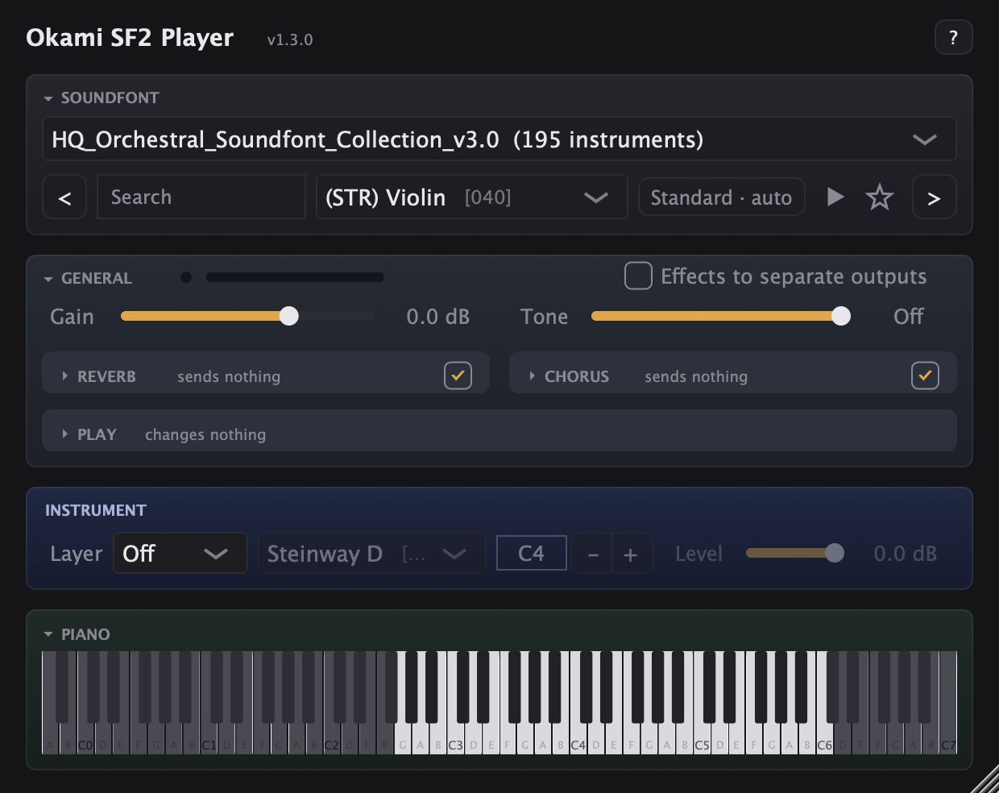

# Okami SF2 Player

An AU / VST3 instrument (plus a standalone app) that plays SoundFonts (.sf2 and .sf3) through
FluidSynth, the reference SoundFont player, made for Ableton Live on the Mac. At its defaults it
plays exactly what FluidSynth plays (the test suite checks it bit for bit); every control on top
starts neutral.

How to use it: [DOCS.md](DOCS.md). Versions: [CHANGELOG.md](CHANGELOG.md). Credits and
licenses: [CREDITS.md](CREDITS.md).



## Download and install

1. Download `Okami-SF2-Player-<version>.pkg` from this repository's Releases and open it. It
   installs the AU and VST3 into `/Library/Audio/Plug-Ins` (signed and notarized by Apple;
   Apple silicon and Intel, macOS 13 or later).
2. Get a SoundFont. The plugin was made for the
   [HQ Orchestral SoundFont Collection](https://musical-artifacts.com/artifacts/817) (522 MB,
   195 instruments), not included here (see CREDITS.md).
3. Restart Ableton Live (or rescan plug-ins), add **Okami SF2 Player** to a MIDI track and open
   the SoundFont from its menu.

## Tech stack

| Part | What | Notes |
|---|---|---|
| Plugin framework | JUCE 8.0.15 | AU, VST3, Standalone; CMake + Ninja, no Xcode project |
| Synth engine | FluidSynth 2.6.2, static, float | patched: `fluidsynth-fx-bypass.patch` |
| SF3 decoding | libvorbisfile / libvorbis 1.3.7, libogg 1.3.5 | static |
| Target | macOS 13+, universal (arm64 + x86_64) | built and used on an M4 with macOS 27; the Intel half is tested under Rosetta |
| Identity | manufacturer `Mrgt`, plugin `Sf2p`, AU `aumu` | never change: projects find the plugin by them |

## Building from source

```sh
brew install cmake ninja

# The dependencies go in ThirdParty/ (ignored by git), at these exact versions.
git clone --depth 1 --branch 8.0.15 https://github.com/juce-framework/JUCE.git ThirdParty/JUCE
git clone --depth 1 --branch v2.6.2 https://github.com/FluidSynth/fluidsynth.git ThirdParty/fluidsynth
git clone --depth 1 --branch v1.3.5 https://github.com/xiph/ogg.git ThirdParty/ogg
git clone --depth 1 --branch v1.3.7 https://github.com/xiph/vorbis.git ThirdParty/vorbis

# libogg and libvorbis (static, universal, into ThirdParty/xiph-install):
cd ThirdParty && I=$PWD/xiph-install
for lib in ogg vorbis; do (cd $lib && cmake -B build -G Ninja -DCMAKE_BUILD_TYPE=Release \
  -DCMAKE_OSX_ARCHITECTURES="arm64;x86_64" -DCMAKE_OSX_DEPLOYMENT_TARGET=13.0 -DCMAKE_POSITION_INDEPENDENT_CODE=ON \
  -DBUILD_SHARED_LIBS=OFF -DCMAKE_PREFIX_PATH=$I -DCMAKE_INSTALL_PREFIX=$I -DCMAKE_POLICY_VERSION_MINIMUM=3.5 \
  && cmake --build build && cmake --install build); done

# FluidSynth (static, universal, float, no audio drivers, the patch applied, SF3 through libvorbisfile):
cd fluidsynth && git apply ../../fluidsynth-fx-bypass.patch && cmake -B build -G Ninja -DCMAKE_BUILD_TYPE=Release \
  -Denable-floats=ON -DCMAKE_OSX_ARCHITECTURES="arm64;x86_64" -DCMAKE_OSX_DEPLOYMENT_TARGET=13.0 \
  -DCMAKE_INSTALL_PREFIX=../fluidsynth-install -DCMAKE_POSITION_INDEPENDENT_CODE=ON -DBUILD_SHARED_LIBS=OFF \
  -DCMAKE_C_FLAGS="-DSF2PLAYER_VORBISFILE=1 -I$I/include" -DCMAKE_CXX_FLAGS="-DSF2PLAYER_VORBISFILE=1 -I$I/include" \
  -DCMAKE_EXE_LINKER_FLAGS="$I/lib/libvorbisfile.a $I/lib/libvorbis.a $I/lib/libogg.a" \
  -Denable-framework=OFF -Denable-coreaudio=OFF -Denable-coremidi=OFF -Denable-aufile=OFF -Denable-dbus=OFF \
  -Denable-ipv6=OFF -Denable-jack=OFF -Denable-ladspa=OFF -Denable-libsndfile=OFF -Denable-midishare=OFF \
  -Denable-network=OFF -Denable-oss=OFF -Denable-sdl3=OFF -Denable-pulseaudio=OFF -Denable-pipewire=OFF \
  -Denable-readline=OFF -Denable-openmp=OFF -Denable-native-dls=OFF -Denable-signalsmith=OFF -Denable-alsa=OFF \
  -Denable-systemd=OFF -Denable-portaudio=OFF && cmake --build build && cmake --install build && cd ../..

# The plugin: native by default (pass -DCMAKE_OSX_ARCHITECTURES="arm64;x86_64" for universal).
# The build also installs the AU and VST3 into ~/Library/Audio/Plug-Ins.
cmake -B build -G Ninja -DCMAKE_BUILD_TYPE=Release
cmake --build build
ctest --test-dir build --output-on-failure
auval -v aumu Sf2p Mrgt
```

FluidSynth's build downloads its `gcem` submodule from GitHub the first time if it's missing.

## Project structure

| File | What it holds |
|---|---|
| `CMakeLists.txt` | the plugin target, three console test targets, ctest, the version |
| `Source/PluginProcessor.h/.cpp` | parameters, the FluidSynth engine (created, swapped under a lock), MIDI routing (transpose, velocity curve, layer/split, program changes), MIDI kept while the engine is busy, rendering into six channels, tone filter, gain, outputs, saved state, missing-file handling |
| `Source/PluginEditor.h/.cpp` | the look (`SF2Look`), the keyboard with key ranges and the split tint, every control, instrument lists by family with favorites, effect presets, preview |
| `Source/SoundFontInfo.h` | what FluidSynth doesn't expose, read from the file itself: name, author, comment, each preset's key range and reverb/chorus sends (bounded against hostile files) |
| `Tests/PluginTests.cpp` | the test suite (what `ctest` runs) |
| `Tests/TailTest.cpp` | tools: render a note to WAV, CPU per block, list sends, snapshot the editor |
| `Tests/RenderTest.cpp` | plays a note offline and prints the presets with key ranges |
| `Tests/fonts/` | Vintage Dreams Waves .sf2 and .sf3 (Ian Wilson, freeware, unaltered, with its notice) |
| `fluidsynth-fx-bypass.patch` | every change to FluidSynth (see Key systems) |
| `scripts/release.sh` | builds, tests, signs, packages and notarizes a release |
| `DOCS.md`, `CHANGELOG.md`, `CREDITS.md`, `CLAUDE.md` | user guide, versions, credits, notes for Claude sessions |

## Architecture

- **One FluidSynth per plugin instance** (`Engine`: settings, synth, font id). Loading a file or
  changing the sample rate builds a new one off the audio thread and swaps it in under
  `engineLock`, a `SpinLock`; the old one is freed outside the lock. Every FluidSynth call
  happens under that lock.
- **The audio thread never waits.** It only *try*-locks. While the message thread holds the
  lock (choosing an instrument reads its samples from disk), the block stays silent and its
  MIDI is kept in a fixed array (`deferMidi`), played at the start of the next block. Nothing
  there allocates: sysex is skipped by size before any message is built, and past a reserve
  continuous values (controllers, pressure, bends) keep only their last value per channel,
  while note-offs, pedals, program and bank changes, RPN/NRPN and resets keep their order.
- **Shared state** (the file, the preset list and choices, the sample rate) is guarded by
  `stateMutex`, taken by the message thread, by `prepareToPlay` and `setStateInformation`
  (which a host may call from another thread) and by the editor's accessors (which return
  copies); never by the audio thread, and always before `engineLock`.
- **Saving never waits:** `getStateInformation` reads a small snapshot of the file and the
  instruments (`savedSoundFont`, under its own SpinLock), kept current by whoever changes them,
  so a host saving while a SoundFont loads isn't held up.
- **Message-thread housekeeping** (a 10 Hz timer, `runMessageThreadTasks`): tells the host the
  project changed (outside `stateMutex`, so the host's handler can't deadlock with a waiting
  `prepareToPlay`), pins the presets a clip switched to, and reloads a missing file once it's
  back or an unreadable one once it changes (otherwise after a wait doubling from 1 to 30
  minutes).
- **Settings reach FluidSynth from the audio thread:** `processBlock` compares the parameters
  with what it last applied (`EffectSettings`, `PlaySettings`) and sends only what changed, so
  moving one knob never resets another setting (or MIDI state a clip set).
- **32 FluidSynth channels:** MIDI channels 1-16 play the instrument on 0-15, and the layer on
  16-31. Note-offs go to both sides and use the note actually played (`playedNote`), so a
  transpose or a layer change mid-note never leaves a note stuck.
- **Six rendered channels per block** (`work`): main L/R, reverb L/R, chorus L/R, from
  `fluid_synth_process`. Built-in effects: the effect channels are added to main. Send outputs:
  FluidSynth hands out the raw sends (patch) and they go to buses 2 and 3.
- **State ownership:** parameters live in the `AudioProcessorValueTreeState`; the file, the
  instrument and the layer instrument are plain members saved with it; recent files and
  favorites live in the editor's settings file (shared by every instance and project).

## Key systems

- **Fidelity.** Extra controls are FluidSynth's own mechanisms: SF2 generator offsets
  (`fluid_synth_set_gen`, the same as NRPN: attack, release, fine tune, layer attenuation), its
  legato, portamento and basic-channel modes, pitch-wheel sensitivity. Offsets are rounded so a
  default adds exactly 0 (a knob's x1 was stored as 0.99999994 and moved the release once). A
  clip's Reset All Controllers (CC121) clears FluidSynth's offsets; the plugin puts its own back.
- **Interpolation.** `FLUID_INTERP_HIGH`, FluidSynth's 17-point sinc: within -63 to -85 dB of its
  25-point one, closer to ideal than the 4th-order default (-43 dB). FluidSynth 2.6 computes
  the sinc's sines per sample; the patch tabulates the kernel (1024 phases, linear between),
  about 10x faster: 64 string notes take about 10 % of a 128-sample block.
- **The FluidSynth patch** (`fluidsynth-fx-bypass.patch`):
  - `fluid_synth_set_fx_bypass`: the raw effect sends, for the separate outputs.
  - The sinc kernel tabulated, and its table built when the synth is created, not by the
    first note on the audio thread.
  - Sample rates up to 192 kHz (FluidSynth capped them at 96, so above that everything played
    an octave low), with the chorus delay line doubled above 96 kHz only: up to 96 kHz the
    chorus is bit-identical to FluidSynth's.
  - SF3 decoding through libvorbisfile without libsndfile, checked against ffmpeg's decoder:
    within one 16-bit step, every sample exactly as long as in the .sf2 original.
- **Memory.** Dynamic sample loading: only the chosen instruments' samples are in RAM (a 522 MB
  collection costs a track tens of MB). A MIDI program change applies at once, as in
  FluidSynth (a note sent with it plays the new instrument; exports are exact); its preset is
  then pinned, so switching back to it never reads the disk again. The first switch to an
  instrument not yet in memory reads it on the audio thread.
- **Hostile files.** FluidSynth validates a file before our reader runs; our reader still
  clamps every index to its chunk and bounds its total work. Tested with garbage, truncated and
  crafted files.
- **Host integration.** Choosing a file or an instrument calls
  `updateHostDisplay (withNonParameterStateChanged)`, so Ableton asks to save. The instruments
  are saved by bank:program. A missing file's path is kept in the project and shown ("Can't
  find"); one that exists but can't be read says "Can't open". Either is loaded again within a
  second of coming back or changing (or a minute later, for a file still downloading).

## Settings reference

Parameters (automatable, saved in the project; IDs with their version):

| ID | Range | Default | Notes |
|---|---|---|---|
| `gain` | -24 to +12 dB | 0 | after the synth |
| `tone` | 1 kHz to 20 kHz | 20 kHz = Off | 4-pole Butterworth low-pass |
| `fsReverbOn` | bool | on | |
| `fsReverbLevel`, `fsReverbRoom`, `fsReverbDamping`, `fsReverbWidth` | 0-1 | 0.7, 0.5, 0.2, 0.8 | FluidSynth's defaults |
| `fsChorusOn` | bool | on | |
| `fsChorusLevel` | 0-2 | 0.6 | |
| `fsChorusRate` | 0.1-5 Hz | 0.2 | |
| `fsChorusDepth` | 0-20 ms | 4.25 | |
| `fsChorusVoices` | 1-10 | 3 | |
| `sendOutputs` | bool | off | raw sends on the Reverb / Chorus Send outputs |
| `attack`, `release` | x0.25 to x4 | x1 | envelope time multipliers (timecent offsets) |
| `velocityCurve` | -100 to +100 | 0 = Linear | exponent 2^(-v/50) |
| `transpose` | -24 to +24 st | 0 | on the note number |
| `fineTune` | -100 to +100 ct | 0 | |
| `bendRange` | 1-24 st | 2 | |
| `playMode` | Poly / Mono / Legato | Poly | |
| `glide` | 0-2000 ms | 0 = Off | portamento, linear time mode |
| `layerMode` | Off / Layer / Split | Off | |
| `splitKey` | 1-127 | 60 (C4) | keys below it play the layer in Split |
| `layerLevel` | -30 to 0 dB | 0 | SF2 attenuation on channels 16-31 |

Saved alongside the parameters: `sf2Path`, `preset`, `presetBank`, `presetNumber`,
`layerBank`, `layerNumber` (state tag `SF2Player`).

Settings file `~/Library/Application Support/SF2 Player/SF2 Player.settings`: `recentFiles`
(last 12) and `favorites` (`<file name>|<bank>:<program>`, one per line).

## Tests

`ctest` runs `PluginTests` (42 checks). Each renders through the real processor and fails on a
wrong result:

- **Fidelity:** bit-identical output to FluidSynth at the defaults.
- **Playing:** each PLAY control measured (level, and pitch by autocorrelation), layer and split
  (which side plays), tone, the mod wheel's vibrato.
- **MIDI:** a note-off arriving while an instrument loads still stops the note; 8,000 events
  during a load keep the last bend and volume; a reset isn't undone by an earlier bend; a
  program change applies to the note sent with it, back and forth; Fine survives CC121.
- **Outputs and formats:** send outputs, SF3, in tune at 44.1, 96 and 192 kHz.
- **State and files:** the saved state (file, instruments, knobs), saving without waiting for a
  load, a missing file kept, a file
  lost during a rate change reported then reloaded, a failed rebuild not undoing a newer file,
  global key ranges, hostile files refused quickly.
- **CPU:** 64 string notes under 30 % of a 128-sample block (reported, not judged, under
  Rosetta).

With `~/Downloads/HQ_Orchestral_Soundfont_Collection_v3.0.sf2` present it also checks that
collection (195 instruments, 125 with reverb sends, 47 with chorus).

`TailTest` tools: `<file> <preset> wav <out.wav> <key> [tone Hz]` (`EFFECTS=1` keeps the reverb
and a 15 ms chorus on), `<file> <preset> perf` (`INTERP=4..7` picks the interpolation),
`<file> sends`, `<file> <preset> snap <out.png> [sends]` (`LAYER=2` for split).

## Releasing

`scripts/release.sh` builds universal, runs the tests on both architectures and auval (checking
it validated this version), signs both bundles (Developer ID, hardened runtime, timestamp, no
get-task-allow), builds a signed installer that always installs into `/Library/Audio/Plug-Ins`,
notarizes and staples it: `dist/Okami-SF2-Player-<version>.pkg` and its SHA-256.

It needs "Developer ID Application" and "Developer ID Installer" certificates in the keychain.
Apple lets only the team's **Account Holder** create them (Xcode → Settings → Apple Accounts →
the team → Manage Certificates → +), signed in with that Apple ID; neither an Admin nor an App
Store Connect API key can. Notarization uses an App Store Connect API key set in
`scripts/release.env` (ignored by git). Then attach the .pkg to a GitHub release:
`gh release create v<version> dist/*.pkg dist/*.sha256 --notes-file <notes>`.

## License

Okami SF2 Player's own code is AGPLv3 (`LICENSE`). FluidSynth is LGPL-2.1, linked statically
with the changes in fluidsynth-fx-bypass.patch; the steps above rebuild it from source, so it
can be replaced as the LGPL requires. libogg and libvorbis are BSD. Every project used, and the
HQ collection's status, are in CREDITS.md.
